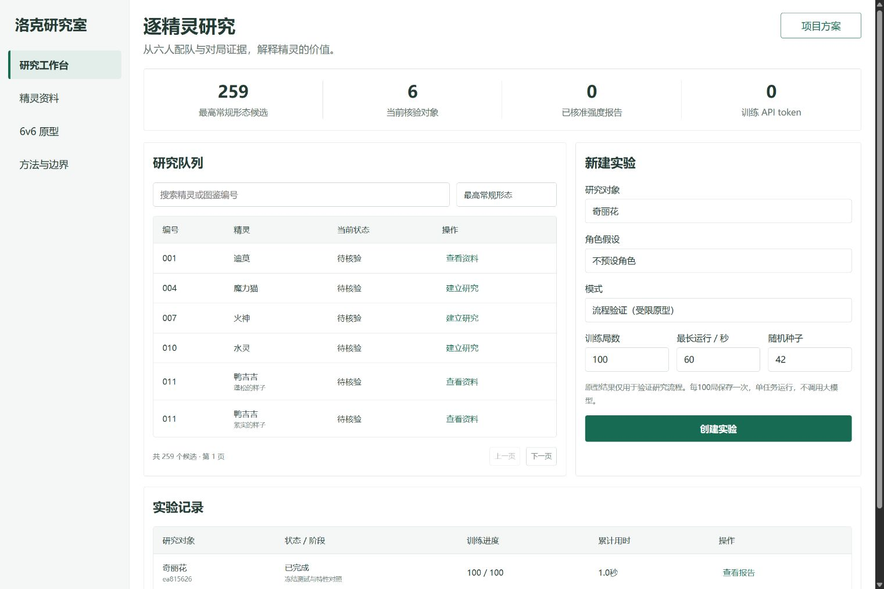

# 洛克研究室

**在六人配队中研究一只精灵：它适合什么玩法，价值来自哪里，强势是否有合理代价。**

洛克研究室是面向《洛克王国：世界》的独立平衡研究项目。它尝试用强化学习探索对战策略，再通过配队比较和机制对照，为精灵设计与平衡调整提供依据。

**当前工作台：** [打开开发分支](https://github.com/Pacific-shark/roco-balance-lab/tree/private/individual-research-v1)。下方运行命令会直接拉取该分支。

[项目方案](https://github.com/Pacific-shark/roco-balance-lab/blob/private/individual-research-v1/docs/project-plan-v4.md) · [对战规则](https://github.com/Pacific-shark/roco-balance-lab/blob/private/individual-research-v1/docs/official-battle-rules.md) · [实验样例](https://github.com/Pacific-shark/roco-balance-lab/blob/private/individual-research-v1/examples/prototype-run.json) · [本地运行](#本地运行)



> **当前进度：研究流程原型。** 已接通资料库、6v6 自博弈、候选队伍筛选和证据报告；可执行环境仍限于 10 个形态、42 个技能。现阶段用于验证方法，不提供正式服强度榜或最优配队推荐。

## 为什么做这个项目

一只精灵所在的队伍赢得多，不一定说明它本身过强。优势可能来自搭档、特定对位、技能补盲，也可能只是对手还没有学会反制。

本项目要回答的是：**把它放进适合的队伍后，它究竟贡献了什么？如果需要调整，应该改哪里，又会损失什么玩法？**

研究对象可以是进攻手、防守位、支援位或轮转成员。每次研究固定它在队伍中占一席，不预设它必须是核心，也不以伤害量替代团队价值。

## 一次研究如何进行

1. **选择对象**：按图鉴编号查阅精灵、技能池和资料来源，确认当前能执行哪些机制。
2. **探索配队**：生成包含研究对象的六人候选队伍，让两个独立策略通过对战学习出招、聚能和换人。
3. **筛选打法**：在验证对手上比较候选，最多保留三套有成员差异的队伍，再用未参与筛选的配置测试。
4. **追问原因**：固定策略与对局条件，比较保留、移除目标特性的表现，并查看触发事件和回合记录。
5. **形成判断**：把证据放回评价维度，区分已经观察到的现象和下一步需要验证的解释。

例如，当一支队伍表现很好时，先检验目标精灵的特性是否真的改变了局面。若移除特性后表现基本不变，就应继续检查技能分配、搭档协同或对手覆盖，而不是直接把高得分归因于特性。当前实现了特性对照；技能补盲、同定位替换和双方重新训练的系统对照仍在后续计划中。

## 如何评价精灵

| 维度 | 要回答的问题 | 当前证据 |
| --- | --- | --- |
| 竞技表现 | 在哪些队伍和对位中有效？ | 原型测试的逐局结果与对局得分 |
| 个体贡献 | 换成同定位精灵，队伍会失去什么？ | 待补同定位替换与重新训练 |
| 玩法特色 | 特性是否改变决策与资源使用？ | 冻结策略下的特性移除对照、事件记录 |
| 反制与代价 | 对手能否反制，优势付出了什么成本？ | 待补补盲、技能槽和资源成本实验 |
| 设计一致性 | 实际玩法是否符合有依据的设计目标？ | 待补设计依据与人工评阅 |

目前不把五个维度加权成总分。报告保留缺失证据，也区分“冻结策略后的直接变化”和“双方重新适应后的结果”。前者已经接通，后者尚未完成。

## 当前版本能做什么

| 模块 | 已实现 |
| --- | --- |
| 资料管理 | 固定 BWIKI 快照、SQLite 存储、来源与版本记录；收录 631 个形态、824 条技能／特性记录 |
| 训练与筛选 | 两份独立参数的策略梯度、规则与历史对手、有限候选搜索、训练／验证／测试配置分离 |
| 实验管理 | 局数与累计时限预算、每 100 局保存检查点、暂停与恢复、版本变化后拒绝续用旧检查点 |
| 研究报告 | 六人配招、逐局结果、特性对照、事件证据与 JSON 导出 |
| 操作界面 | 精灵检索、实验创建、任务进度、报告查看；支持桌面与手机布局 |

资料收录范围大于战斗执行范围；631 个形态不代表已支持全图鉴训练。完整共鸣、首领化等机制及玩家可见信息尚未接入正式执行器，因此正式强度研究入口保持关闭。

已保存一份 [100 局训练、112 局评估的流程样例](https://github.com/Pacific-shark/roco-balance-lab/blob/private/individual-research-v1/examples/prototype-run.json)。它证明当前流程可以运行，不证明训练稳定提升或发现了真实游戏的最强队伍。[验证记录](https://github.com/Pacific-shark/roco-balance-lab/blob/private/individual-research-v1/docs/evidence/workbench-verification-2026-10-16.json)包含 72 项 JavaScript 测试、32 项 Python 测试，以及构建和界面检查结果。

## 本地运行

需要 **Node.js 24+** 和 **pnpm 11.25.0**。当前工作台代码位于 `private/individual-research-v1` 分支。

```sh
git clone --branch private/individual-research-v1 https://github.com/Pacific-shark/roco-balance-lab.git
cd roco-balance-lab
pnpm install --frozen-lockfile
pnpm build
pnpm start
```

打开 **http://127.0.0.1:4198**。仓库目前为私有，克隆需要有访问权限的 GitHub 账号；没有公开在线演示。

首次启动会导入仓库内的固定资料。实验和检查点存放在 `.local/research.sqlite`，不上传 GitHub。

**训练与评估在本地运行，不需要模型 API Key，不消耗大模型 API token。** 默认 100 局、60 秒累计时限，一次运行一个任务；开发对话、CPU 与运行时间不包含在“0 API token”里。

<details>
<summary>开发与检查命令</summary>

```sh
# 终端 1：本地 API
pnpm start

# 终端 2：前端热更新，http://127.0.0.1:4197
pnpm dev

# Node.js 测试
pnpm test

# Python 机制与资料检查（需要 Python 3）
python -m unittest discover -s test -p 'pilot_*_test.py'
```

前端开发服务将 API 请求代理到 4198 端口。受限环境若无法创建测试子进程，可运行 `node --test --test-isolation=none test/*.test.mjs`。

</details>

## 下一步

- 补齐当前版本的战斗机制和可见信息，用逐事件样例核准结算，再扩大可执行精灵范围。
- 扩展配队、配招与培养的联合搜索，比较多个训练种子，检查策略是否真的学会支援、轮转和资源规划。
- 加入同定位替换、关键技能调整及双方重新训练，让报告能够提出有证据的平衡建议。

数据库结构、训练方法和阶段验收条件见 [项目方案](https://github.com/Pacific-shark/roco-balance-lab/blob/private/individual-research-v1/docs/project-plan-v4.md)；规则依据及待确认项见 [对战机制核查](https://github.com/Pacific-shark/roco-balance-lab/blob/private/individual-research-v1/docs/official-battle-rules.md)。

## 来源与许可

精灵与技能资料来源于 [洛克王国：世界 BWIKI](https://wiki.biligame.com/nrc/首页)，仓库保留固定快照及来源信息，不保证自动同步游戏后续更新。原创代码采用 [MIT](LICENSE)，BWIKI 派生资料按 CC BY-SA 4.0 保留署名，详见 [NOTICE](NOTICE.md)。本项目为独立研究，与腾讯、魔方工作室及 BWIKI 无隶属关系。
